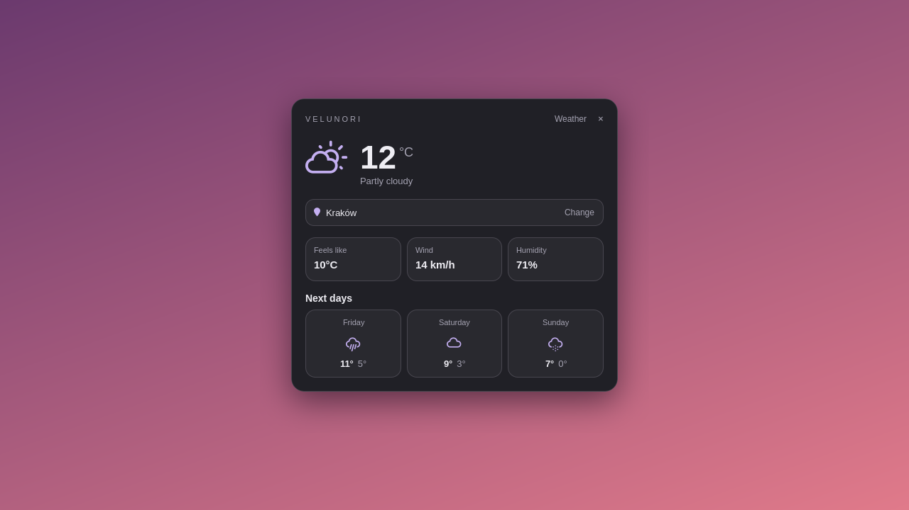

# Velunori Weather

> The weather in the bar, with a forecast panel in the Velunori style.



## Features

- Bar icons and icon-only slots follow Omarchy’s active `Style.bar` sizes, including theme/font changes.

- The current condition as an icon in the bar; hover for temperature, condition and place.
- The panel aligns with the center of its Island/Orbit capsule, including capsules moved to either side of the screen.
- A panel with the temperature, a plain-language condition, feels-like, wind and humidity, and the next seven days as compact rows with low/high temperatures.
- All saved cities appear together with their current temperature and conditions. Click a city for its weekly forecast; this leaves the bar’s primary city unchanged.
- Click **Cities** to manage saved places and choose the primary city for the bar, remove a place, or choose **Add city** to search. The current configured city is imported automatically; choosing a new search result saves it for later. **Automatic location** restores IP detection.
- Each selected city has its own current conditions and weekly forecast. Previous-city data clears while the new forecast loads, and outdated responses are discarded.
- Units follow your setting, then the country of the report, then the system locale.
- Right-click sends the weather as a notification; middle-click refreshes.
- Existing keybindings and `omarchy-shell omarchy.weather toggle` keep working, and the stored location is the one Omarchy already uses.

[Saved cities preview](docs/cities.png).

## Requirements

[Velunori Library](https://github.com/Velunori/lib) API 1 (version 1.x), installed in the real sibling `lib/` directory. Works with the stock Omarchy bar; Floating Bars is optional. Developed against **Omarchy 4.0.6-1**.

Forecasts come from [Open-Meteo](https://open-meteo.com) and [wttr.in](https://wttr.in), the same sources the built-in widget uses.

## Install

Install the shared library first, then run from this repository directory:

```bash
bash scripts/install-local.sh
```

The installer backs up `shell.json`, links this checkout, puts the widget where `omarchy.weather` was and restarts the shell. A failure restores the backup.

Restore the built-in weather:

```bash
bash ~/dev/Velunori/weather/scripts/restore-local.sh
```

## Configuration

Settings sit on the widget's entry in `bar.layout`, as with the built-in widget:

```json
{ "id": "velunori.weather", "unit": "metric", "refreshMinutes": 15 }
```

`unit` is `metric`, `imperial`, or left out to decide automatically.

Saved places are stored in `$XDG_STATE_HOME/velunori/weather/cities.json` (normally `~/.local/state/velunori/weather/cities.json`). The selected place continues to use Omarchy’s `weather.json`, so existing weather commands still work. Removing the active saved place returns to automatic location.

## Development

```bash
bash scripts/check.sh
VELUNORI_TEST_LAYOUT=symlink bash scripts/check.sh
```

The check tests weekly forecast parsing, saved-city persistence, QML storage RPC, independent simultaneous city forecasts and fast switching with stand-in weather commands, and condition wording, lints the QML and runs an offscreen test of the panel with sample data.

Render the panel to an image:

```bash
VELUNORI_PREVIEW_PATH=/tmp/weather.png bash scripts/check.sh
VELUNORI_PREVIEW_PATH=/tmp/weather-search.png VELUNORI_PREVIEW_STATE=search bash scripts/check.sh
VELUNORI_PREVIEW_PATH=/tmp/weather-cities.png VELUNORI_PREVIEW_STATE=cities bash scripts/check.sh
```

## Limits

The offscreen test draws the panel from sample data; the live fetching, the bar icon and the panel's placement have not been run in a desktop session yet. The widget has only been designed against the Velunori bar.

## Velunori plugins

Velunori is a set of independent plugins for the [Omarchy](https://omarchy.org) shell. Install only the ones you want; each lives in its own repository and can be removed without touching the others.

| Plugin | What it is |
| --- | --- |
| [bar](https://github.com/Velunori/bar) | The Island and Orbit bars, the appearance settings and the shared design kit |
| [clock](https://github.com/velunori/clock) | Clock in the bar with a month calendar |
| [control-center](https://github.com/velunori/control-center) | Sound, displays, network, capture and reminders in one panel |
| [notifications](https://github.com/velunori/notifications) | Notification cards and a session history |
| [menu](https://github.com/velunori/menu) | The Omarchy command menu as a two-pane panel |
| [update](https://github.com/velunori/update) | A window for `omarchy update` with release notes and live progress |
| **weather** (this repository) | Weather in the bar with a forecast panel |
| [lockscreen](https://github.com/velunori/lockscreen) | Serene lock screen using Omarchy's session lock and authentication |

## License

MIT, see [LICENSE](LICENSE). The fetching and location logic is adapted from Omarchy's MIT-licensed weather panel; see [THIRD_PARTY_NOTICES.md](THIRD_PARTY_NOTICES.md).
